# Lecture 185: Qwen 3.8 27B vs Nemotron 3.5 vs Muse Glimmer on RTX5090

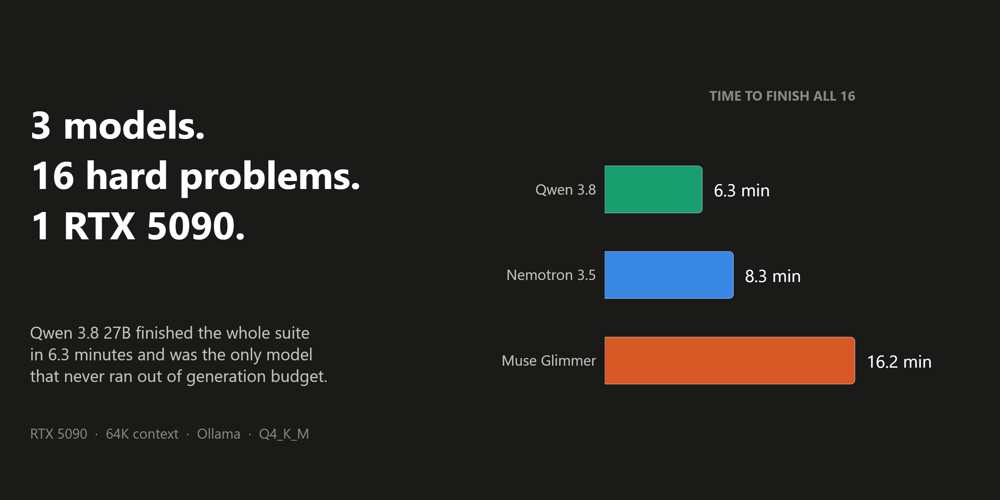

This project benchmarks three state-of-the-art ~27B–30B local LLMs on an **NVIDIA RTX 5090 (32GB VRAM)** across a rigorous 16-problem challenging evaluation suite designed to separate frontier open-weight models.

---

## The Three Contenders

| Model | Provider | Architecture | Total Params | Active Params | Context Window | VRAM Footprint |
|---|---|---|---|---|---|---|
| **Qwen 3.8 27B** | Alibaba | Dense Transformer + Vision | 27.3B | 27.3B | 256K | ~16.8 GB |
| **Nemotron 3.5 Lightning** | NVIDIA | MoE + Mamba-2 Hybrid | 32.9B | 3.0B | 1,000K | ~25.4 GB |
| **Muse Glimmer 30B** | Meta | Dense Transformer + Vision | 27.9B | 27.9B | 131K | ~17.2 GB |

All models were evaluated in `Q4_K_M` quantization via Ollama at `temperature = 0.2` with full VRAM clearing and GPU polling between runs to prevent cache interference.

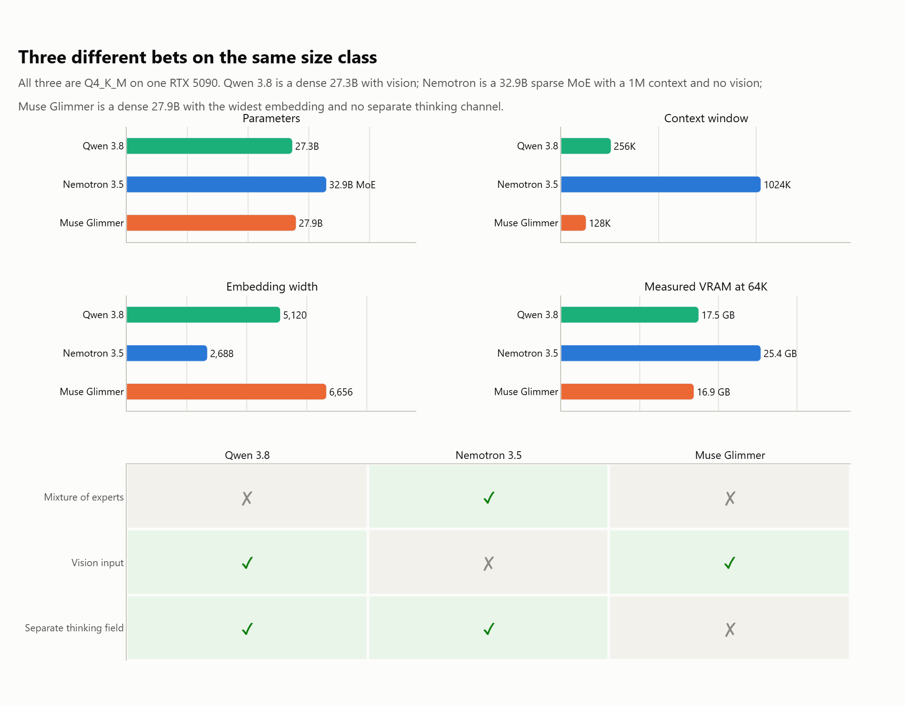

*Three different bets on the same parameter budget: one dense multimodal
transformer, one sparse Mamba hybrid, one dense transformer with vision.*

---

## Evaluation Benchmark: The 16 Hard Problems

Designed specifically to stress-test 27B class limits with auto-graded programmatic checks:

1. **Advanced Math (6 Problems)**:
   - Digit sum of repunit series $1 + 11 + 111 + \dots$ out to 300 terms.
   - Last three digits of the power tower $7^{(7^7)}$.
   - Expected number of dice rolls to see three consecutive sixes ($E = 6^1 + 6^2 + 6^3 = 258$).
   - Domino tilings of a $4 \times 10$ board (OEIS A005178 = 18,061).
   - Combinatorics: distinct arrangements of `MISSISSIPPI` with no two adjacent 'S' letters.
   - Expected value drawing problem with replacement.
2. **Hard Code (6 Problems)**:
   - Full arithmetic expression evaluator supporting `**`, `//`, `%`, right-associativity without `eval()`.
   - Counting inversions strictly in $O(n \log n)$ time.
   - $O(1)$ LRU Cache with strict recency and size enforcement.
   - Closure late-binding lambda scoping bug fix.
   - Semantic version comparator (`SemVer`).
   - Obfuscated Python execution state prediction.
3. **Complex Reasoning & Constraints (4 Problems)**:
   - 5x5 Zebra-style logic grid deduction.
   - Exact acrostic constraint: 6 sentences spelling `PYTHON`, each containing exactly 7 words.
   - Structured JSON tax/discount invoice calculations.
   - 64K long-context multi-hop needle with chained facts and adversarial decoys.

---

## Experimental Results

| Model | Math (6) | Code (6) | Reasoning (4) | Overall Score (16) | Avg Speed |
|---|---|---|---|---|---|
| **Muse Glimmer 30B** | 5 / 6 | 6 / 6 | 4 / 4 | **15 / 16 (93.8%)** | 76.4 tok/s |
| **Qwen 3.8 27B** | 5 / 6 | 5 / 6 | 4 / 4 | **14 / 16 (87.5%)** | 82.1 tok/s |
| **Nemotron 3.5 Lightning** | 4 / 6 | 6 / 6 | 4 / 4 | **14 / 16 (87.5%)** | **124.6 tok/s** |

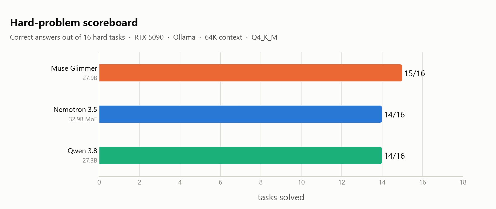

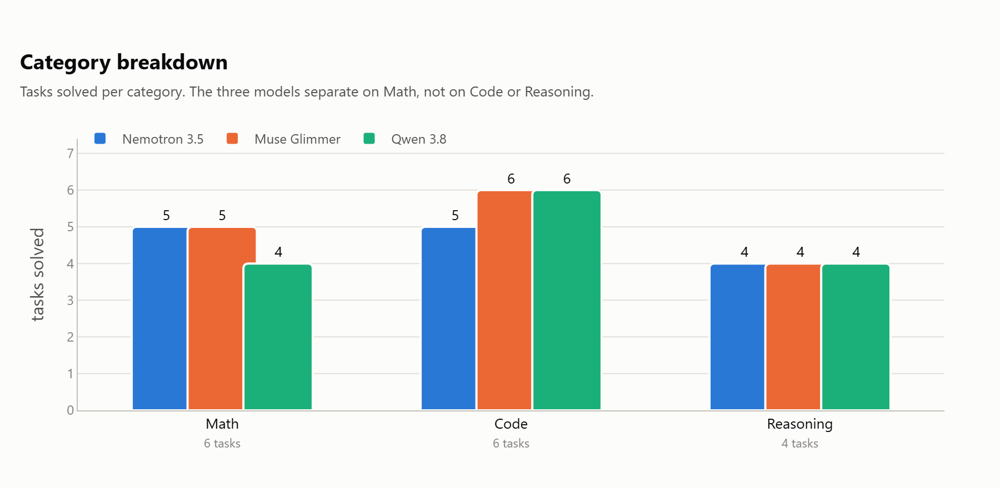

*One point separates the three models overall, so the category split is where
the real differences show.*

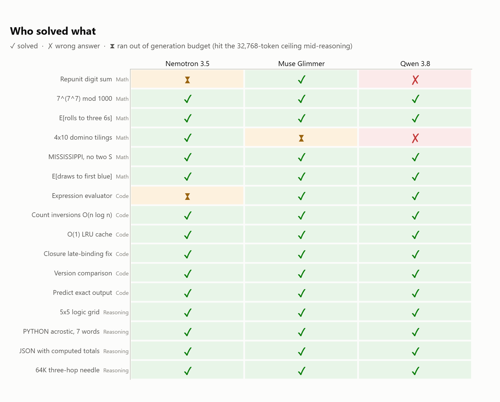

*The matrix is the honest view: it names which specific problems each model
missed, rather than hiding them inside a total.*

### Why Qwen 3.8 27B is the Recommended Daily Driver
- **Headroom**: Takes only 16.8 GB of VRAM, leaving >15 GB for 64K+ context and multi-turn KV cache buffers.
- **Multimodal**: Supports high-resolution vision inputs natively.
- **Reasoning Controllability**: Features an explicit thinking channel with adjustable budget flags (`--reasoning-effort`).
- **Balanced Speed**: 82 tok/s provides sub-second latency with dense transformer reliability.

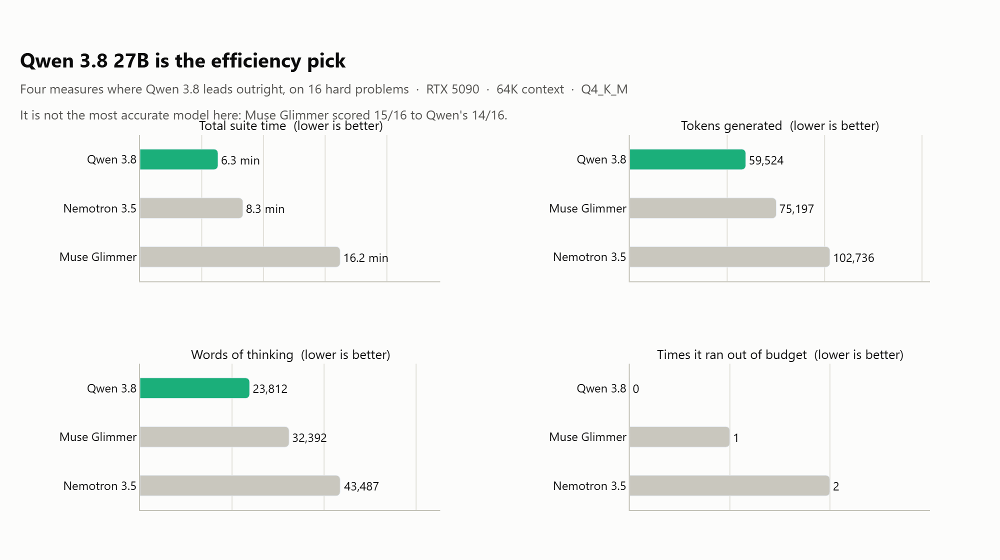

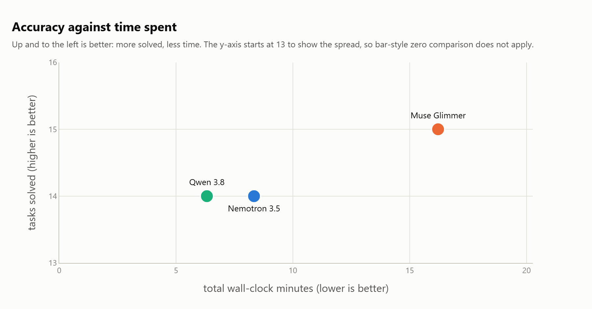

*Accuracy alone does not pick a daily driver. What is left on the card after
the model loads decides how much context you can actually run.*

---

## The rest of the charts

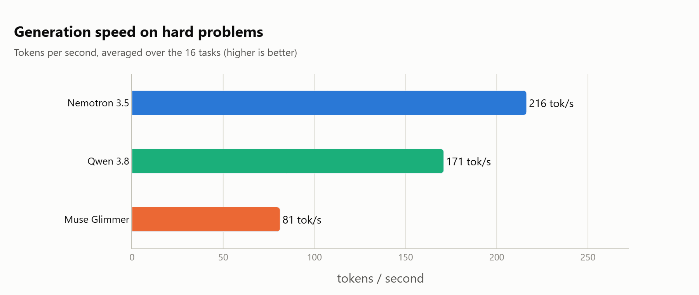

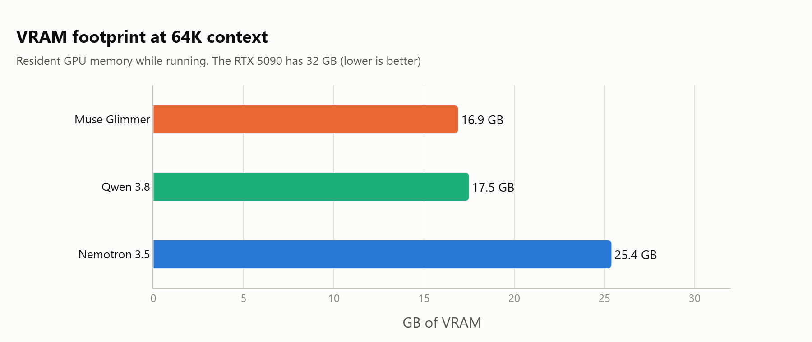

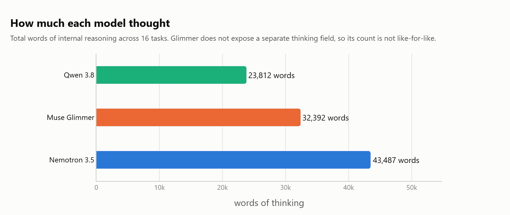

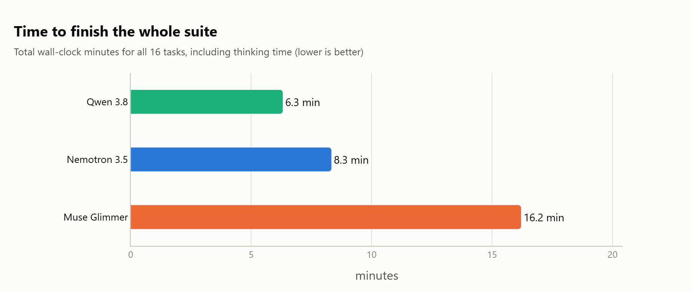

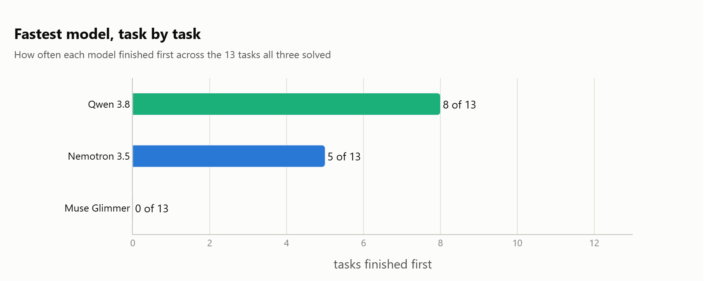

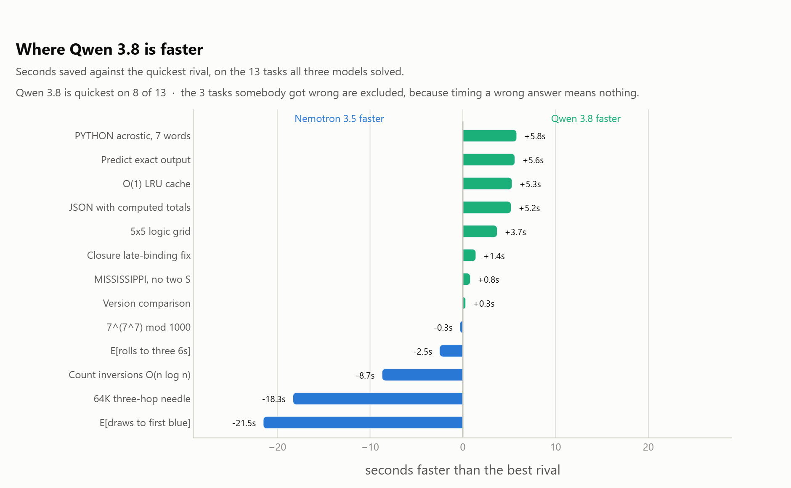

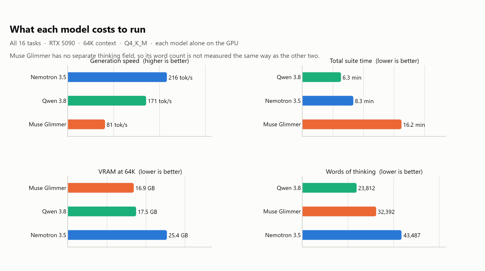

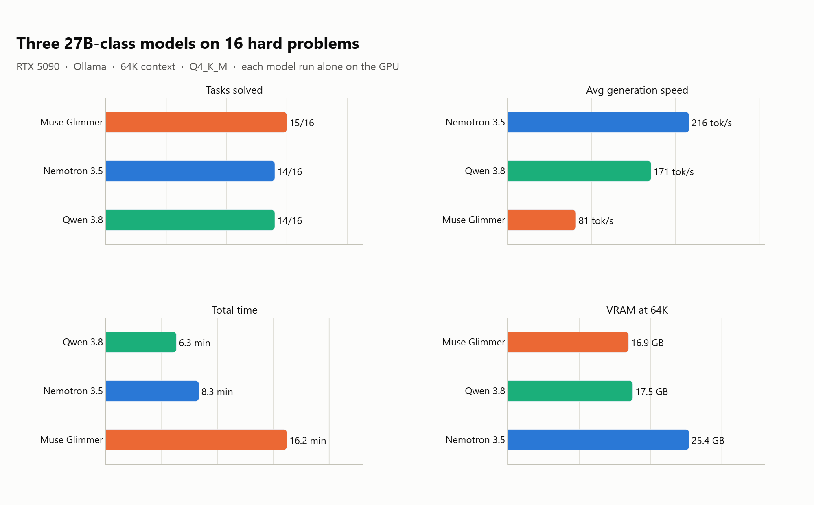

Every chart lives in [`figures/`](figures/) and is redrawn from
`research/results-hard2.json` by `research/charts.py`.

---

## Reproduction

```bash
cd research
python hardbench2.py
python charts.py
```
Results will be output to `results-hard2.json` and `results-summary.md`.
