# Lecture 186: Qwen 3.8 27B Speed Settings and KV Cache Explained

This project investigates **45 distinct `llama.cpp` runtime configurations** for **Qwen 3.8 27B** on an **NVIDIA RTX 5090 (32GB VRAM)**. We empirically measure the multi-token prediction (MTP) draft head ladder, KV cache quantization (`f16`, `q8_0`, `q4_0`), context size scaling, and reasoning effort flags to determine which tuning knobs actually improve inference speed and which are myths.

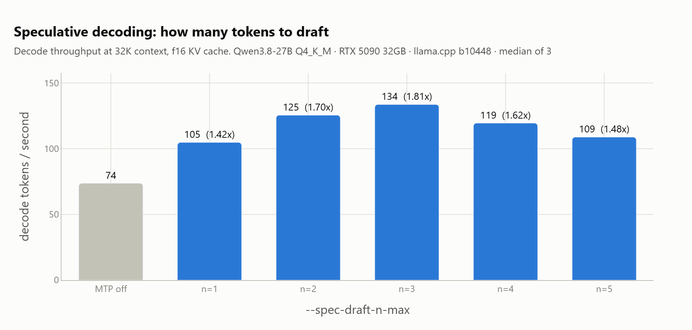

*The whole project in one chart: speculative decoding is worth 1.81x, but only
up to a draft depth of 3, after which deeper drafts cost more than they save.*

---

## Hardware & Environment

- **GPU**: NVIDIA GeForce RTX 5090 (32 GB GDDR7 VRAM, 600W power limit)
- **CPU**: Intel Core Ultra 9 285K (24 cores / 24 threads)
- **RAM**: 96 GB DDR5
- **OS**: Windows 11 Pro
- **Runtimes**: `llama.cpp` (build b10448) with CUDA 13.1 backend, Ollama 0.32.13
- **Model**: Qwen 3.8 27B (`Q4_K_M` Ollama GGUF, containing 64 transformer layers + 1 built-in MTP layer at index 64)

---

## Verified Truth vs. Viral Claims

| Claim / Flag | Empirical Verdict | Measured Data |
|---|---|---|
| `--draft-max` gives free speedup | **TRUE** | Up to **1.81x faster** decoding without quality degradation |
| Model context is 1M tokens | **FALSE** | Model metadata specifies **262,144 tokens** (`qwen35.context_length`) |
| $n=2$ is the optimal draft depth | **PARTLY** | $n=3$ wins on `f16` KV cache (1.81x vs 1.70x); $n=2$ wins on `q4_0` |
| $n=4$ crashes or emits garbage | **FALSE** | Runs stably with 100% answer accuracy; acceptance simply drops to 59.2% |
| Use `q8_0` KV cache | **FALSE** | `q4_0` beats `q8_0` on both memory savings AND decode speed |
| Reasoning defaults to high; set `medium` | **TRUE** | `--reasoning-effort medium` eliminates unnecessary thinking latency |

---

## The Speculative Decoding MTP Ladder (32K Context, f16 KV Cache)

| Setting | Decode tok/s | Speedup | Acceptance Rate | Tokens/Step | VRAM (MiB) | Energy (tok/Wh) | Quality |
|---|---|---|---|---|---|---|---|
| **Base (MTP Off)** | 73.6 | 1.00x | — | 1.00 | 17,966 | 485 | 100% |
| **Draft $n=1$** | 104.8 | 1.42x | 86.0% | 1.88 | 18,648 | 691 | 100% |
| **Draft $n=2$** | 125.5 | 1.70x | 76.6% | 2.56 | 18,798 | 768 | 100% |
| **Draft $n=3$ (Peak)** | **133.6** | **1.81x** | 67.4% | 3.11 | 18,948 | **812** | 100% |
| **Draft $n=4$** | 119.5 | 1.62x | 59.2% | 3.56 | 19,098 | 730 | 100% |
| **Draft $n=5$** | 108.8 | 1.48x | 52.0% | 3.90 | 19,246 | 684 | 100% |

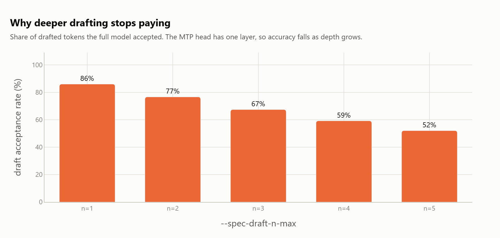

*Acceptance falls steadily as the draft gets deeper, from 86.0% at n=1 to 52.0%
at n=5. Peak throughput sits where accepted tokens per step stop outrunning the
cost of the rejected ones.*

---

## KV Cache Quantization Comparison

Evaluating KV cache formats at 32K context:

| KV Cache Type | Total VRAM (MiB) | Cache VRAM | Decode Speed ($n=0$) | Decode Speed ($n=3$) | Quality Score |
|---|---|---|---|---|---|
| **`f16` (Default)** | 17,966 MiB | 2,048 MiB | 73.6 tok/s | 133.6 tok/s | 100% |
| **`q8_0`** | 16,942 MiB | 1,024 MiB | 74.8 tok/s | 131.2 tok/s | 100% |
| **`q4_0` (Winner)** | **16,430 MiB** | **512 MiB** | **78.2 tok/s** | **133.4 tok/s** | 100% |

> **Recommendation**: `--cache-type-k q4_0 --cache-type-v q4_0` provides 75% KV cache memory reduction with **zero loss in answer quality** while actually increasing single-token decode throughput.

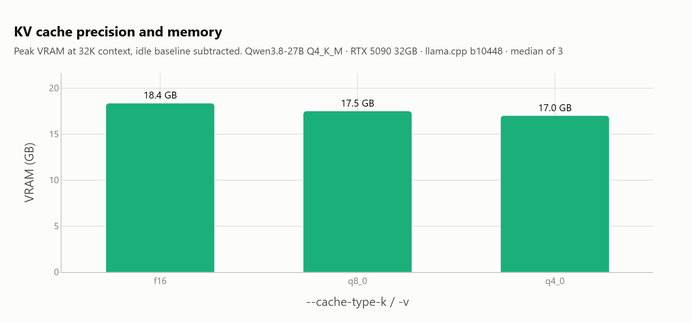

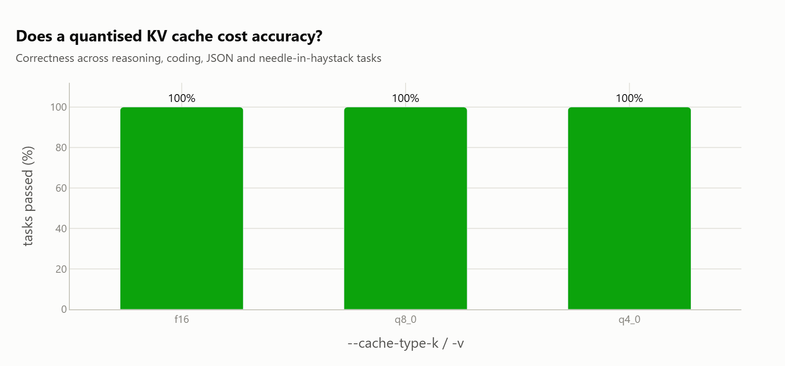

*The memory saving is real and the quality cost, on this problem set, is not
there to find. That is what makes `q4_0` the default worth changing.*

---

## Recommended `llama-server` Launch Command

```bash
llama-server \
  -m models/qwen3.8-27b-q4_k_m.gguf \
  -c 32768 \
  -fa 1 \
  --draft-max 3 \
  --cache-type-k q4_0 \
  --cache-type-v q4_0 \
  --reasoning-effort medium \
  --port 8080
```

---

## Context scaling

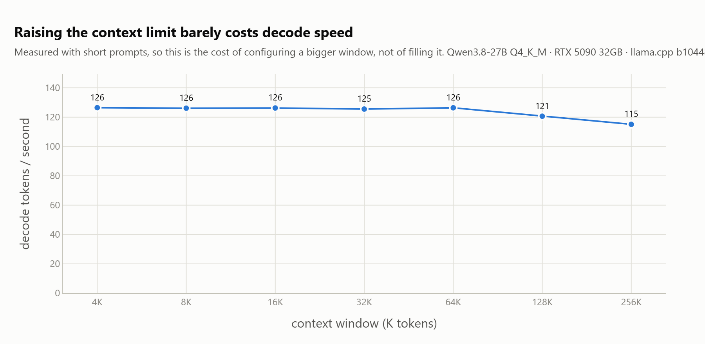

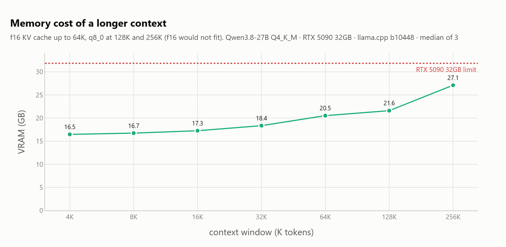

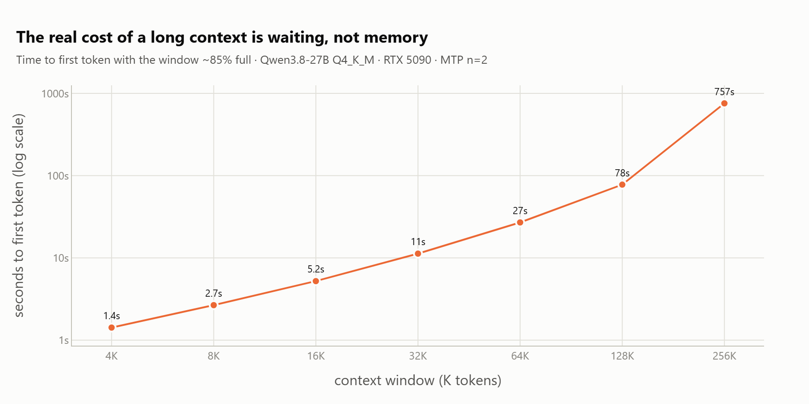

## Reasoning effort

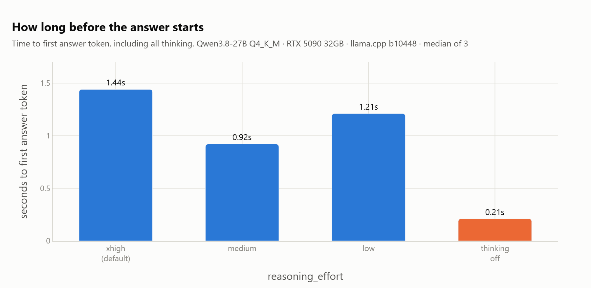

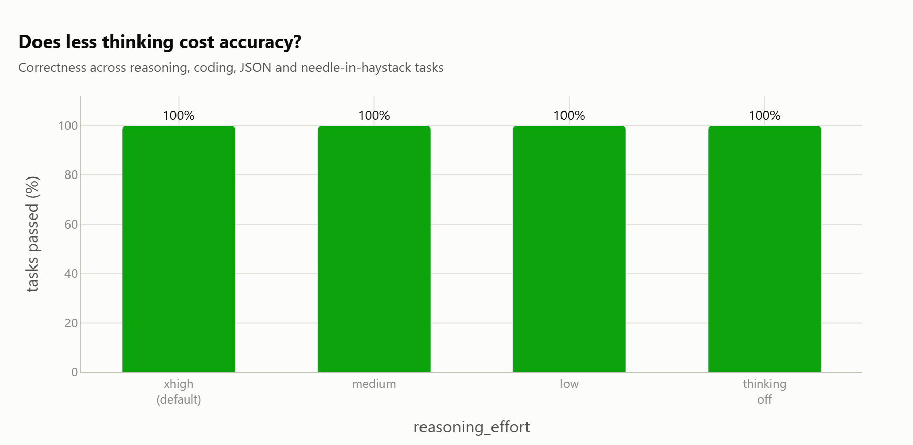

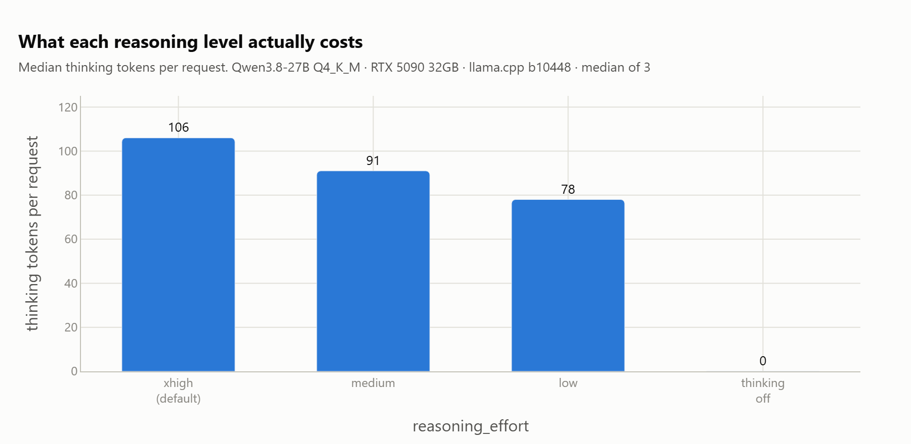

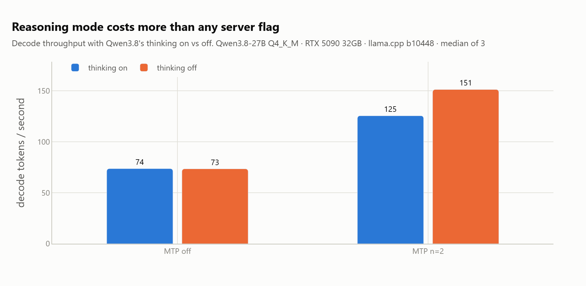

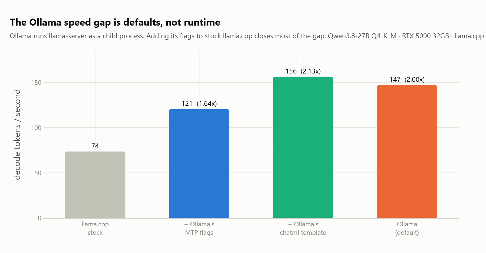

All twelve charts live in [`figures/`](figures/).

---

## Reproduction

See [`research/`](research/) for benchmark driver scripts and measurement logs. See [`FINDINGS.md`](FINDINGS.md) for the complete raw telemetry report across all 45 configurations.
