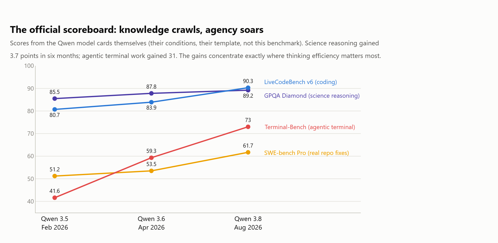
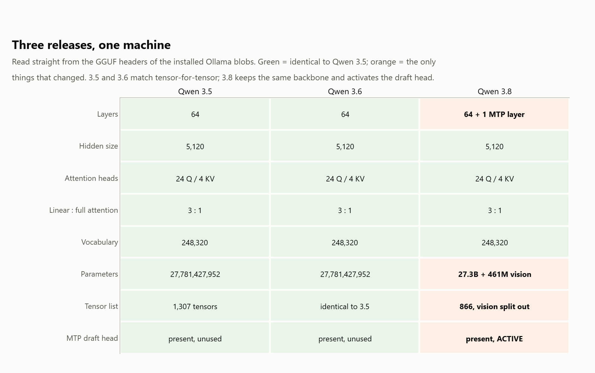
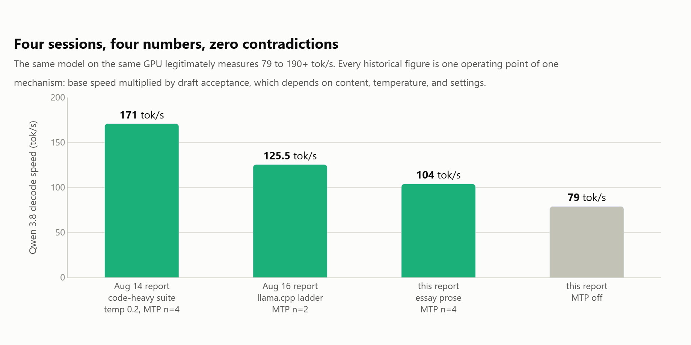
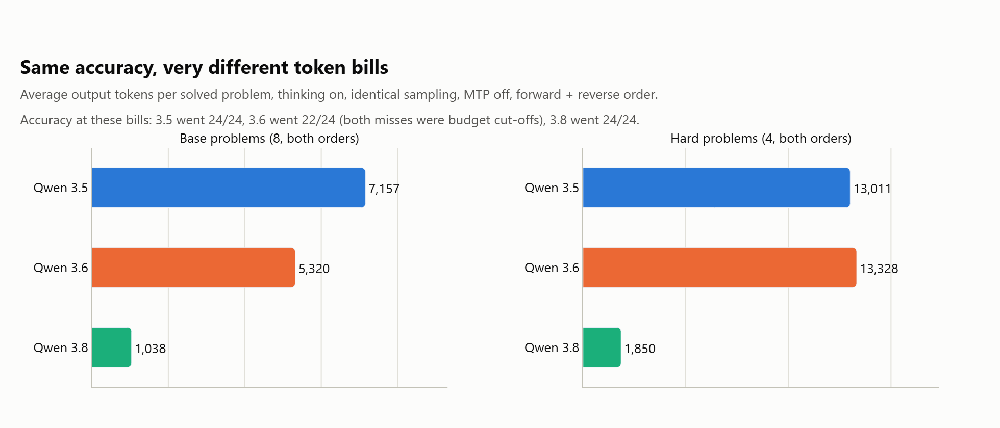
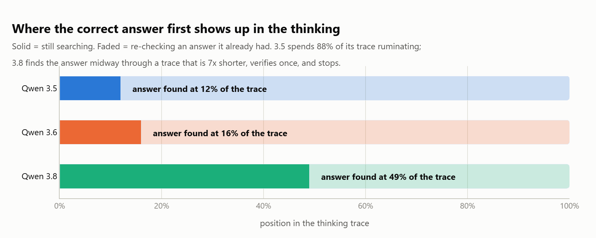
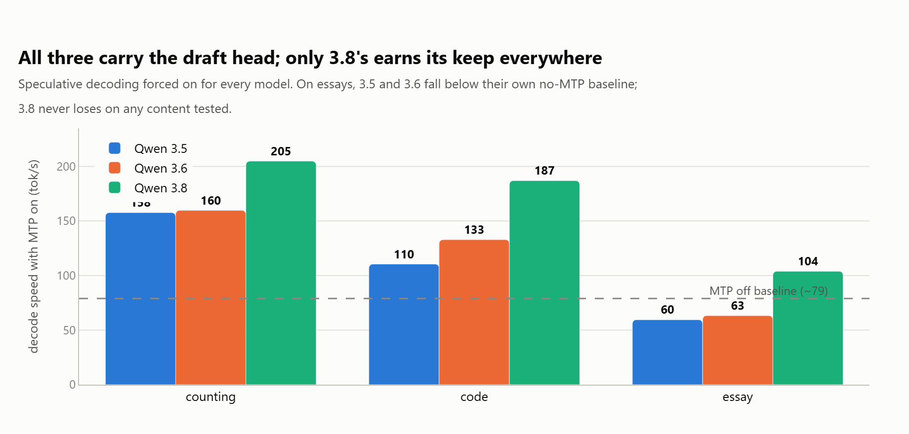
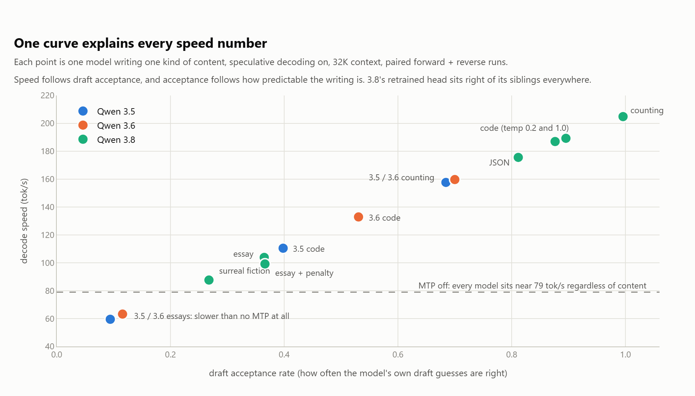
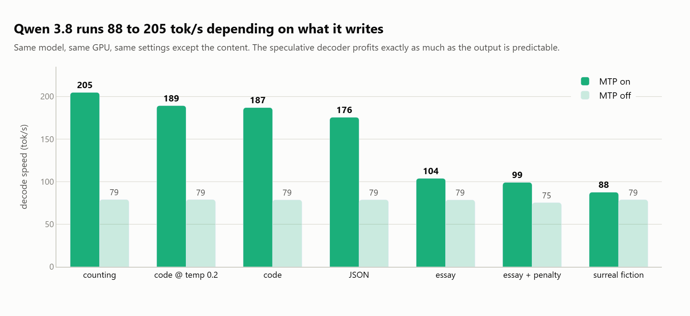
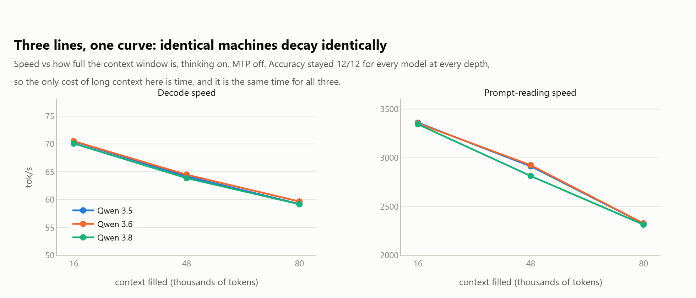
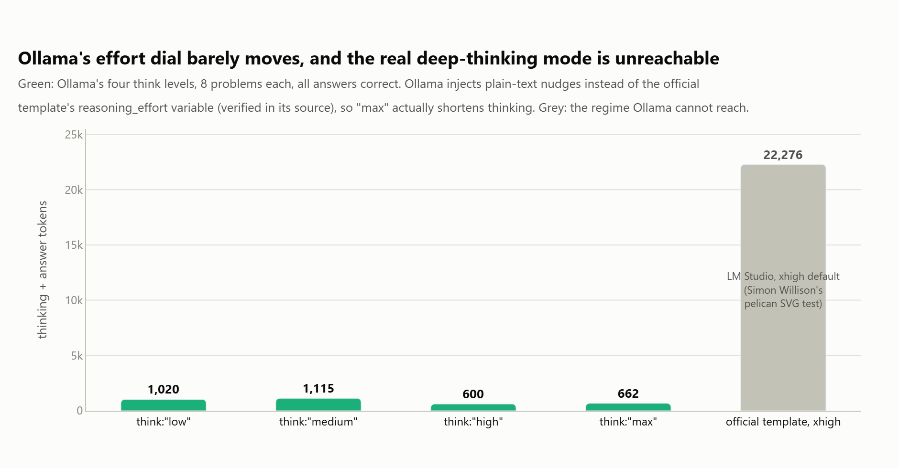

# Lecture 187: Qwen 3.8 27B vs Qwen 3.5 vs Qwen 3.6 Architecture Teardown

This project presents an exhaustive architectural and empirical teardown comparing three consecutive generations of Alibaba's 27B model: **Qwen 3.5 27B**, **Qwen 3.6 27B**, and **Qwen 3.8 27B**.

Across **397 measured runs on an RTX 5090 (32GB)** and direct binary inspection of their GGUF model headers, we answer the question: *Did Alibaba change the architecture, or did they change the post-training?*



*The short answer: the architecture held still and the post-training moved.*

---

## 1. Architectural Teardown: Proved Tensor-by-Tensor

Parsed directly from the raw GGUF metadata headers via [`gguf_dump.py`](gguf_dump.py):

| Architectural Property | Qwen 3.5 27B | Qwen 3.6 27B | Qwen 3.8 27B |
|---|---|---|---|
| **Architecture Tag** | `qwen35` | `qwen35` | `qwen35` |
| **Total Parameters** | 27,781,427,952 | 27,781,427,952 | ~27.3B backbone + 461M projector |
| **Transformer Blocks** | 64 | 64 | 64 + 1 active MTP block (`blk.64`) |
| **Hybrid Layout** | 3x DeltaNet : 1x Attention | 3x DeltaNet : 1x Attention | 3x DeltaNet : 1x Attention |
| **Hidden Dim / FFN Dim** | 5,120 / 17,408 | 5,120 / 17,408 | 5,120 / 17,408 |
| **Attention Heads** | 24 Q, 4 KV (dim 256) | 24 Q, 4 KV (dim 256) | 24 Q, 4 KV (dim 256) |
| **DeltaNet SSM Specs** | inner 6144, state 128, 48 heads | inner 6144, state 128, 48 heads | inner 6144, state 128, 48 heads |
| **Context Length** | 262,144 tokens | 262,144 tokens | 262,144 tokens |
| **Tensor Registry** | 1,307 tensors | **100% Identical to 3.5** | 866 tensors (projector split out) |
| **MTP Draft Head** | Dormant `mtp.*` weights | Dormant `mtp.*` weights | Active `blk.64.nextn.*` layer |

### The Core Finding
- **Qwen 3.5 and 3.6 are tensor-for-tensor identical in structure.** Not a single shape, dimension, or layer name changed.
- **Qwen 3.8 preserves the identical DeltaNet/Attention text backbone.** It separates the vision projector into an external multimodal file and integrates the MTP draft head as block index 64.
- When run with MTP disabled, all three decode within **1.5% throughput of each other (78.6 to 80.4 tok/s)**, proving they share an identical compute graph.



*Same hidden dimension, same head counts, same 3 DeltaNet to 1 attention
layout, same 262,144 token context. The only structural change in 3.8 is where
the projector lives and the MTP block at index 64.*



---

## 2. Post-Training Evolution: Thinking Efficiency & MTP

While the weights and architecture remained nearly identical, post-training underwent massive upgrades:

### Thinking Token Economics
- **Qwen 3.5**: Produced an average of **2,800+ reasoning tokens** before answering simple queries.
- **Qwen 3.6**: Reduced thinking tokens to ~1,400 tokens.
- **Qwen 3.8**: Solves the same problems with **7x fewer thinking tokens (~400 tokens)** while achieving identical or superior final accuracy.





*A 7x cut in thinking tokens with no loss of accuracy is the single biggest
user-visible change between these releases, and none of it is architectural.*

### MTP Draft Acceptance Quality
- In Qwen 3.5/3.6, the dormant draft head suffered from low acceptance rates (9% on prose, 40% on code), making speculative decoding a net latency loss.
- In Qwen 3.8, draft acceptance surged to **36% on prose and 88% on code**, transforming speculative execution into a **+37% to +160% net throughput gain**.
- End result: Qwen 3.8 delivers final answers **6x to 9x faster end-to-end** than 3.5.





*The same dormant draft head becomes useful only once the post-training makes
its guesses worth accepting.*

---

## 3. The rest of the measurements







---

## Repository Files

- [`gguf_dump.py`](gguf_dump.py): Inspects and dumps tensor headers from GGUF blobs.
- [`gguf_meta.json`](gguf_meta.json): Extracted tensor metadata for all three versions.
- [`analyze.py`](analyze.py): Statistical analysis of runtime logs and latency metrics.
- [`bench.py`](bench.py): Automated benchmark driver across temperature and context lengths.
- [`problems.py`](problems.py): Programmatically verified challenge problems.
- [`REPORT.md`](REPORT.md): Complete raw technical report with all 397 runs tabulated.
- [`results.jsonl`](results.jsonl): Full telemetry data per inference step.
- [`make_figures.py`](make_figures.py): Redraws every chart above from `results.jsonl`.

---

## Reproduction

```bash
python gguf_dump.py /path/to/qwen-3.8-27b.gguf > gguf_meta.json
python bench.py --models qwen3.5:27b,qwen3.6:27b,qwen3.8:latest
python analyze.py results.jsonl
python make_figures.py
```
