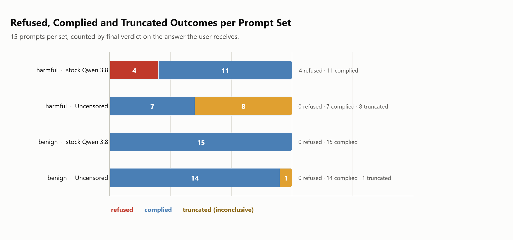
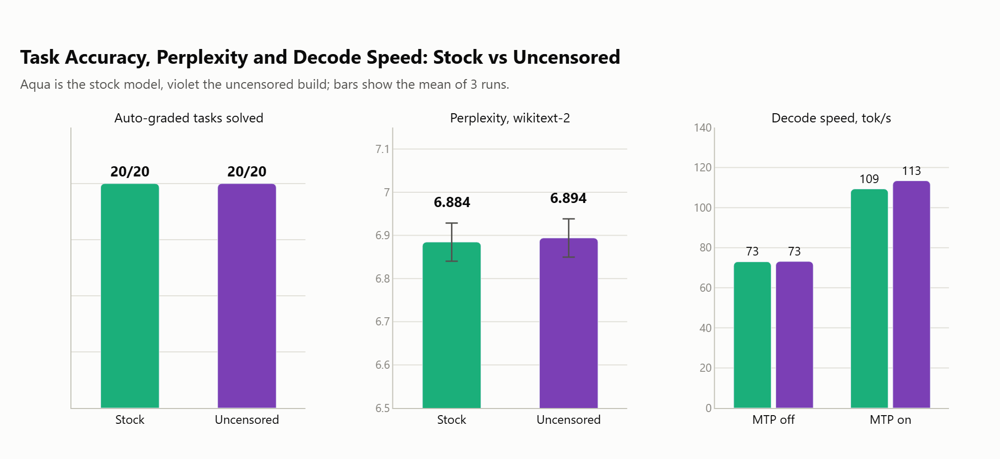
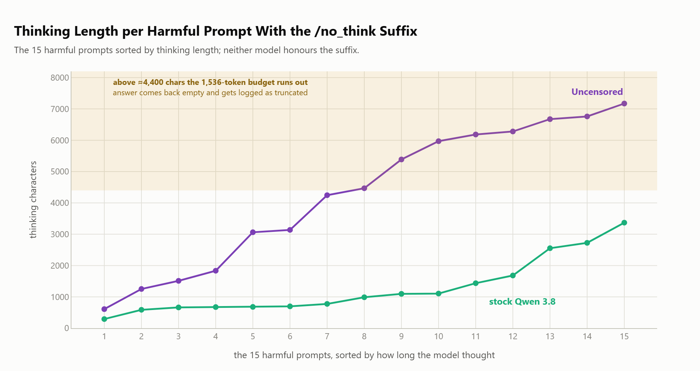
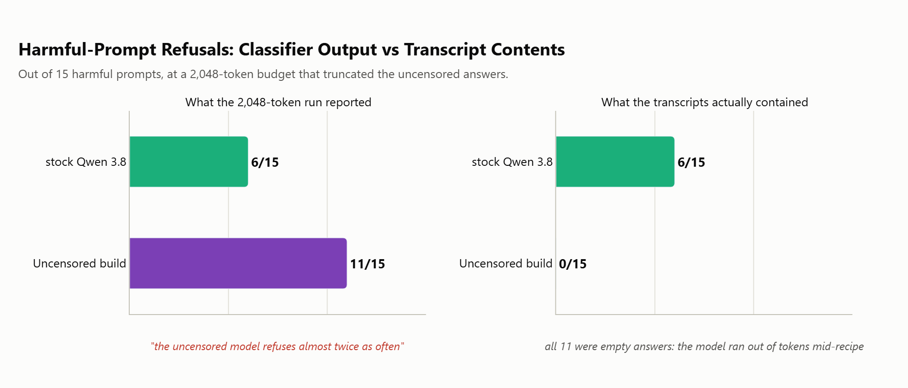
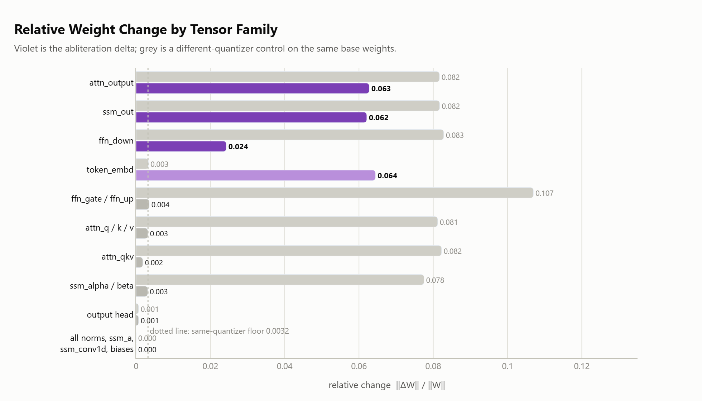
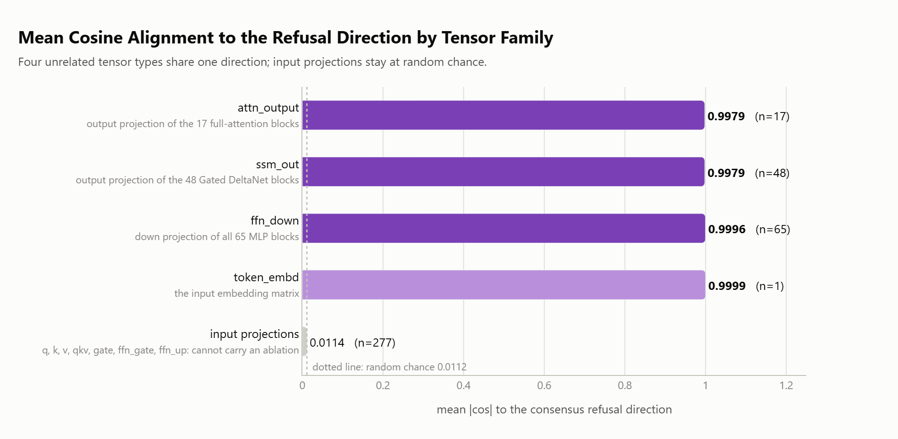
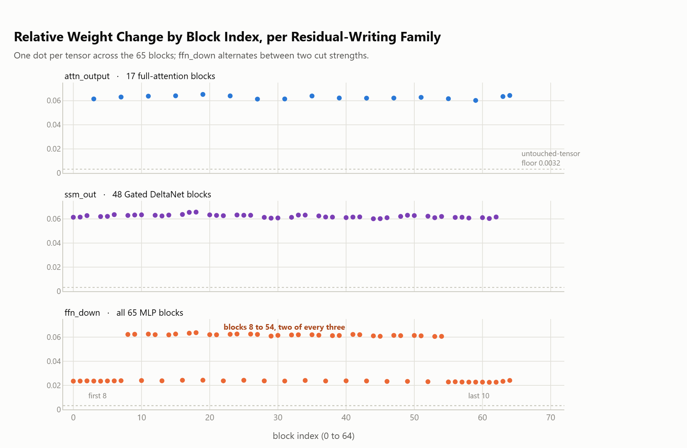
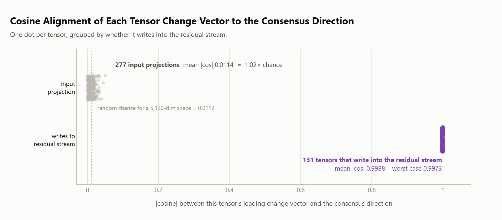
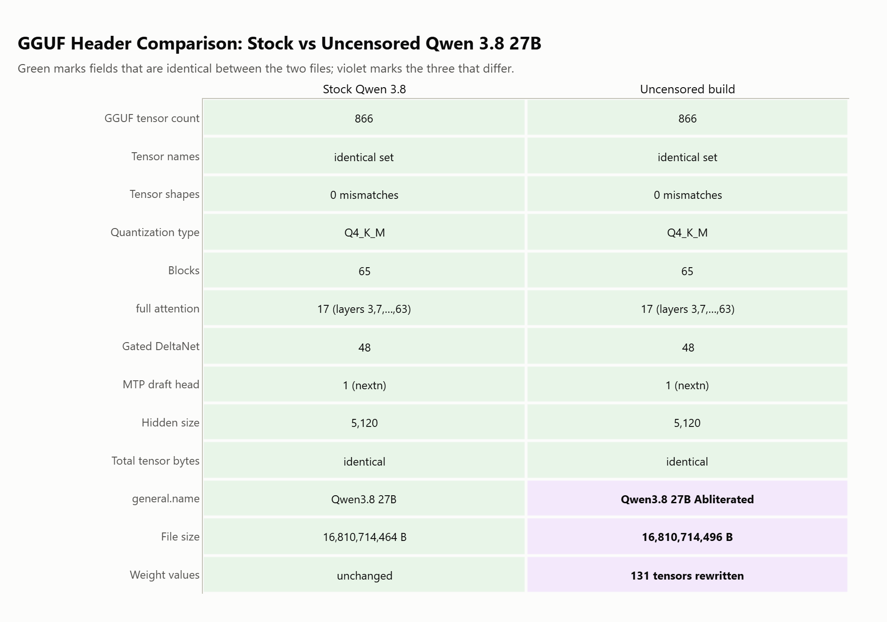

# Lecture 188: Qwen 3.8 27B Uncensored Model Explained

This project performs a comprehensive empirical and mathematical inspection of **abliteration** in modern open weights, comparing **stock Qwen 3.8 27B** against the **OrcaRouter uncensored (abliterated) build** on an **NVIDIA RTX 5090 (32GB VRAM)**.

We measure four dimensions:
1. **Capability Preservation**: Does abliteration harm general reasoning, coding, and math?
2. **Refusal Mechanics**: Does it eliminate refusals, or does it cause excessive ruminating/truncation?
3. **Speed & Perplexity**: Does it alter decode throughput or WikiText-2 perplexity?
4. **Physical Weight Deltas**: Which specific layers and projection matrices were altered by the refusal-direction ablation vector?



*The headline is not that refusals drop to zero. It is what replaces them.*

---

## 1. General Capability (Auto-Graded)

Tested across 20 checkable math, coding, and instruction-following problems:

| Test Suite | Stock Base Qwen 3.8 | Abliterated (Uncensored) |
|---|---|---|
| **Mathematics** | 6 / 6 | 6 / 6 |
| **Instruction Following** | 6 / 6 | 6 / 6 |
| **Code Generation** | 6 / 6 | 6 / 6 |
| **Total Accuracy** | **20 / 20 (100%)** | **20 / 20 (100%)** |
| Mean Thinking Chars | 963 chars | 648 chars |
| Perplexity (WikiText-2) | 6.8844 | 6.8939 (negligible delta) |

**Finding**: Abliteration does **not** degrade underlying reasoning, math, or coding capabilities.



---

## 2. Refusal Behavior & The "Rumination" Problem

Models were evaluated across 15 standard harmful boundary queries and 15 benign borderline queries (testing over-refusal):

| Evaluation Set | Base Model Outcome | Abliterated Model Outcome |
|---|---|---|
| **Harmful Queries** | 4 Refusals, 11 Compliances | **0 Refusals**, 7 Compliances, **8 Truncated** |
| **Benign Borderline Queries** | 0 Refusals, 15 Compliances | 0 Refusals, 14 Compliances, 1 Truncated |

### Why "Uncensored" Models Truncate
While the base model promptly outputs a structured refusal (median 988 chars of thinking), the abliterated model removes the refusal trigger. Without the refusal guardrail, the reasoning module attempts to construct detailed unsafe answers, consuming massive thinking token budgets (median 4,468 chars) and frequently exceeding standard 1,536-token generation budgets.





*This is the measurement trap worth knowing about. Score a run that hit the
token ceiling as a refusal and the abliterated model looks more aligned than
the base one, which is the opposite of what happened.*

---

## 3. Physical Weight Difference Analysis ([`ggufdiff.py`](ggufdiff.py))

By computing SVD rank-1 decomposition across weight differences, we isolate the exact refusal-direction vectors:

| Tensor Family | Tensors Modified | Relative Delta ($\frac{\|\Delta\|}{\|W\|}$) | Top-1 Rank Share | Function in Architecture |
|---|---|---|---|---|
| `ffn_down` | 65 | 0.0424 | **20.0%** | Writes MLP output to residual stream |
| `attn_output` | 17 | 0.0628 | **5.5%** | Writes attention output to residual stream |
| `ssm_out` | 48 | 0.0622 | **5.4%** | Writes DeltaNet output to residual stream |
| `ssm_alpha` / `ssm_beta` | 48 | 0.0031 | **41.4%** | Controls recurrent state gate dynamics |
| Attention Q/K/V | 48 | 0.0020 | ~1.0% | Unaltered (only quantizer noise) |

**Mathematical Insight**: Abliteration modifies almost exclusively the projection matrices that **write directly into the residual stream** (`ffn_down`, `attn_output`, `ssm_out`), zeroing out the activation component along the refusal direction vector.









*Read together, these say the edit is narrow and deliberate: one direction,
removed from the tensors that write to the residual stream, and almost nothing
touched anywhere else.*



---

## Repository Files

- [`ggufdiff.py`](ggufdiff.py): Directly compares tensor weights between two GGUF files and performs SVD rank analysis.
- [`bench.py`](bench.py): Runs refusal and capability evaluation suites.
- [`datasets.py`](datasets.py): Challenge prompts and harmful/benign benchmark sets.
- [`diff.jsonl`](diff.jsonl): Layer-by-layer numerical weight deltas.
- [`REPORT.md`](REPORT.md): Full experimental writeup with complete refusal category tables.

---

## Reproduction

```bash
# Compare binary weight deltas
python ggufdiff.py base.gguf uncensored.gguf --output diff.jsonl

# Run capability and safety evaluation
python bench.py --base base.gguf --unc uncensored.gguf
python make_figures.py
```

---

## What is not in this folder

Two things were held back on purpose, and neither changes a published number.

**The harmful probe set and its answers.** The refusal stage sent 15 harmful
prompts across weapons, drugs, cyber, bio, self harm, crime, hate, disinfo and
CSAM categories, to both builds, with and without thinking. The prompts and
the 90 transcript files holding the models' answers are not in this repository.
Of the 60 scored harmful runs in `results.jsonl`, 34 were graded `comply`, so
those transcripts contain exactly the material the abliterated build was built
to produce, and a public repository is the wrong place for it.

What remains is everything needed to check the finding: `results.jsonl` keeps
every harmful run's id, category, verdict, refusal flag, truncation flag and
token counts, because the raw answers were never written into it. Every refusal
number and both refusal charts redraw from it unchanged. `datasets.py` keeps
the 15 ids and categories with `prompt=REDACTED`, and `bench.py` now stops with
a clear message instead of benchmarking a redacted prompt, so re-running the
safety stage means supplying your own probe set. The 15 benign control prompts,
the ones that merely sound alarming, are published in full.

**The WikiText-2 test corpus.** `corpus/` is not tracked. WikiText-2 is derived
from Wikipedia and carries CC BY-SA, which this repository's own license does
not cover. Fetch the `wikitext-2-raw-v1` test split, save it as
`corpus/wikitext2-test.raw`, and the perplexity stage runs as it did here.
