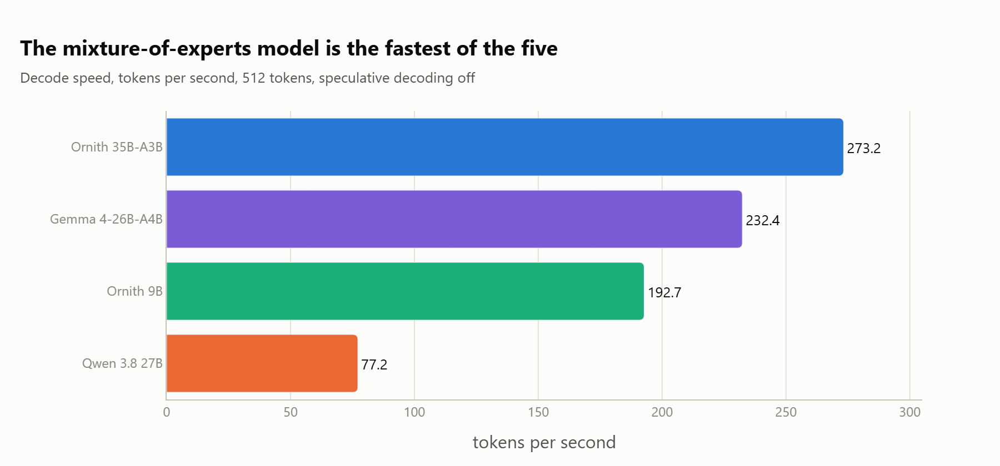
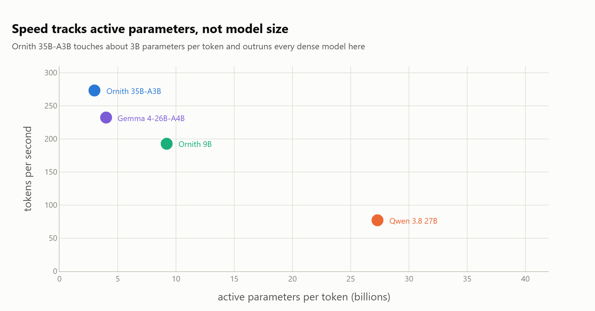
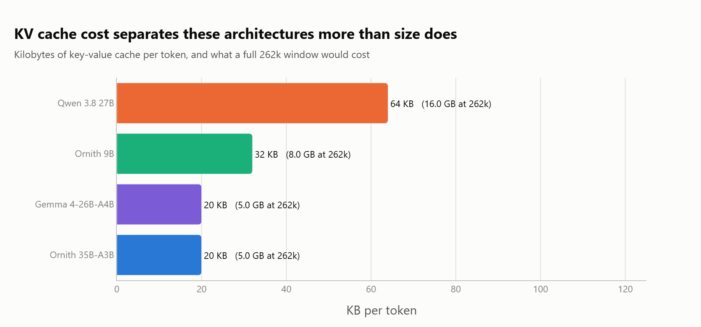
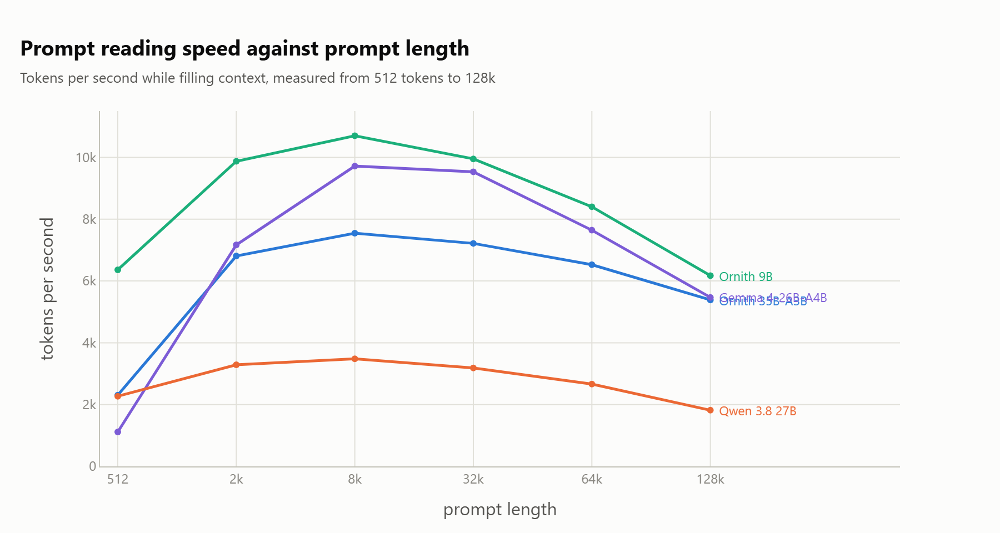
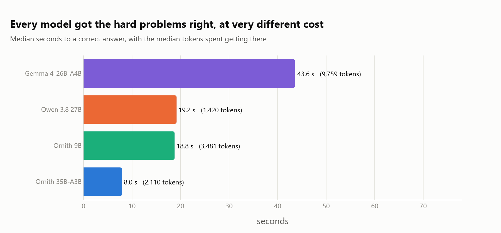
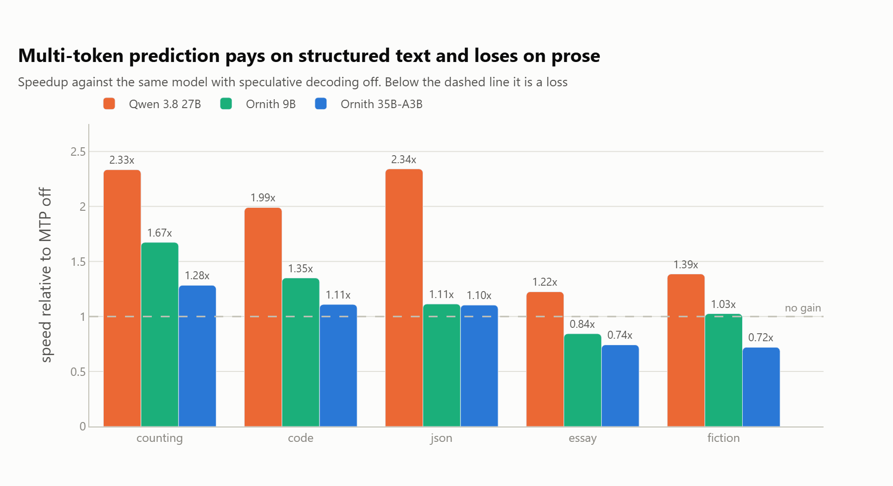
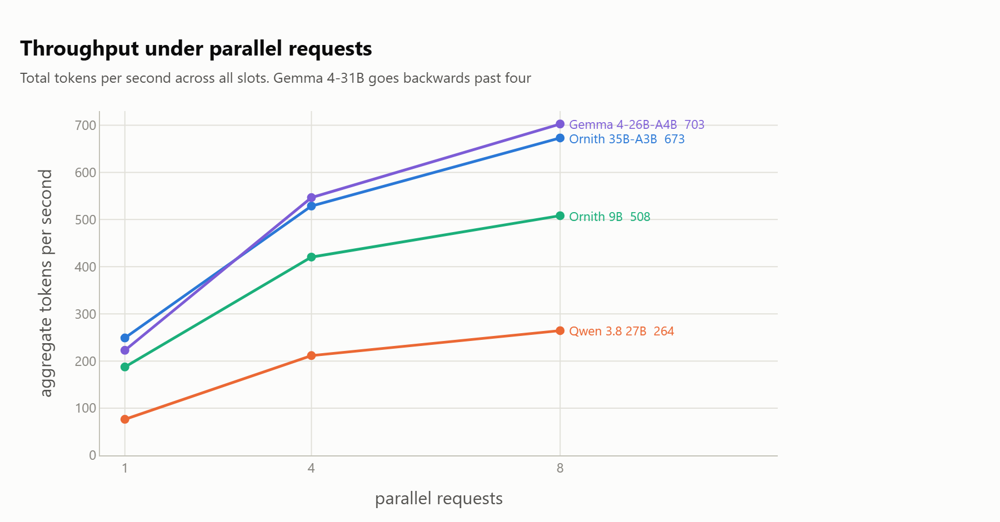
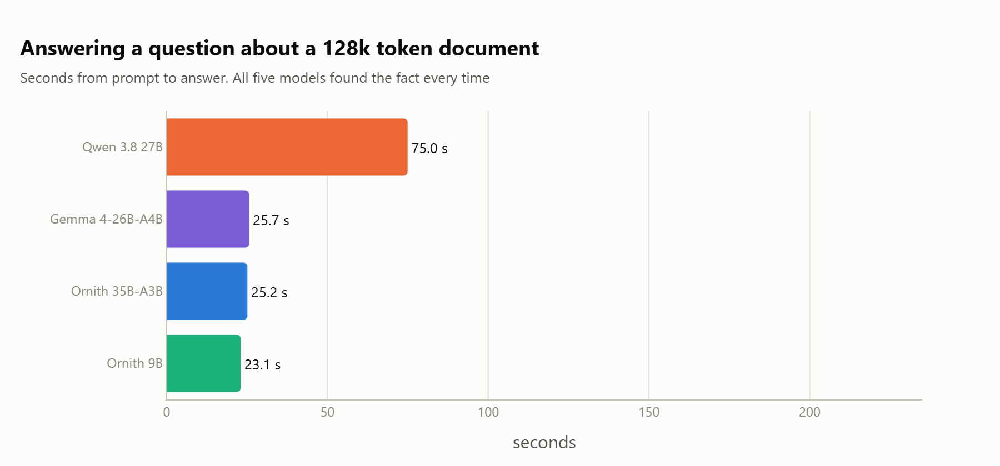
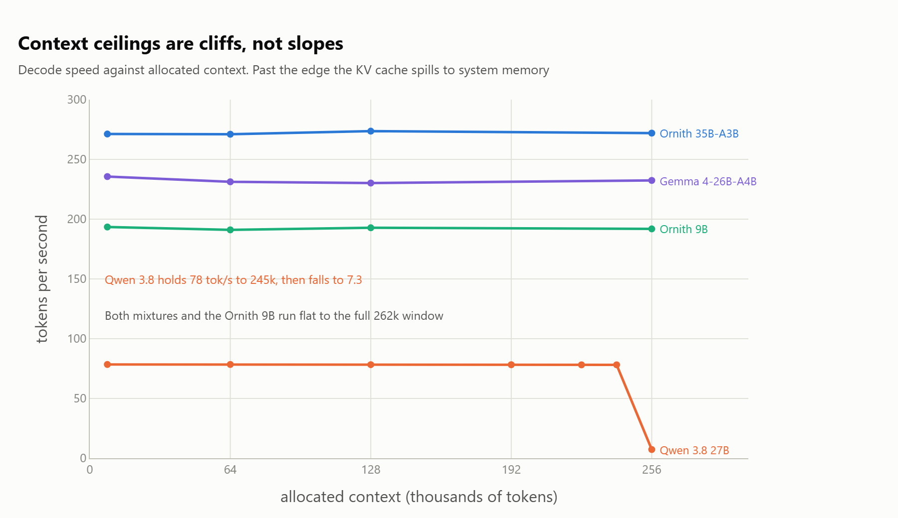

# Ornith 1.5 benchmark

Full local benchmark of **Ornith-1.5-9B** (dense) and **Ornith-1.5-35B-A3B**
(MoE), against the three models the Ornith card names or the rig anchors on:
Gemma 4-31B, Muse Glimmer 30B, and Qwen 3.8 27B.

See [PROTOCOL.md](PROTOCOL.md) for the rules fixed before any data was
collected, and `research/` for the harness.



*Decode speed is where an MoE earns its keep: 35B of stored weights, a
fraction of them touched per token.*

## Layout

| path | what |
| --- | --- |
| `research/` | the harness: one module per benchmark axis |
| `models/` | downloaded Q4_K_M GGUFs |
| `results/` | jsonl output of the real sweep, one file per phase |
| `results_prep/` | preparation-phase probes, kept separate from the sweep |
| `logs/` | llama-server logs, one per configuration |

## Running

```bash
python research/run_all.py
```

Phases run in the order that puts the load-bearing numbers first. Any subset
can be run alone, for example:

```bash
python research/run_all.py --phases speed --models ornith-9b ornith-35b-a3b
```

## Axes measured

1. **Architecture teardown** (`teardown.py`) GGUF metadata and tensor census
2. **VRAM** (`bench_vram.py`) weights, KV bytes per token, compute buffer,
   KV-quant sweep, and a binary search for the context ceiling
3. **Decode throughput** (`bench_speed.py`) tok/s across five content types,
   forward and reverse order
4. **Prefill** (`bench_speed.py --mode prefill`) prompt processing by depth
5. **Multi-token prediction** (`check_mtp.py`, `check_determinism.py`) whether
   the undocumented `nextn` head works, what it buys, and whether it changes
   the output
6. **Concurrency** (`bench_concurrency.py`) aggregate tok/s at 1/2/4/8 slots
7. **Accuracy and thinking economics** (`bench_quality.py`)
8. **Agentic tool use** (`bench_agentic.py`) ten graded multi-step tasks
9. **Long context** (`bench_longctx.py`) needle retrieval to 128k with the
   prefill and VRAM cost at each depth

## Charts

Every chart is redrawn from `results/` by `figures/make_figures.py`. Each one
carries its own axis labels and units.

### What the models cost to run







### What they cost in time







### Where long context breaks





*On Windows, CUDA does not fail when a model runs past VRAM, it silently
spills to host memory. The cliff in decode rate is the only honest signal of
where the real ceiling sits, which is why it is measured rather than inferred
from what loads.*
