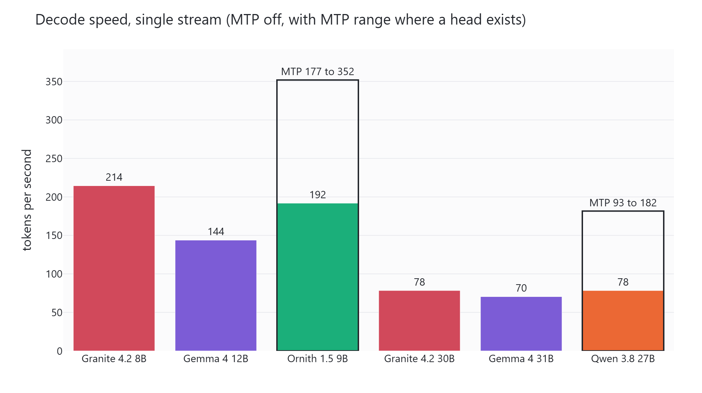
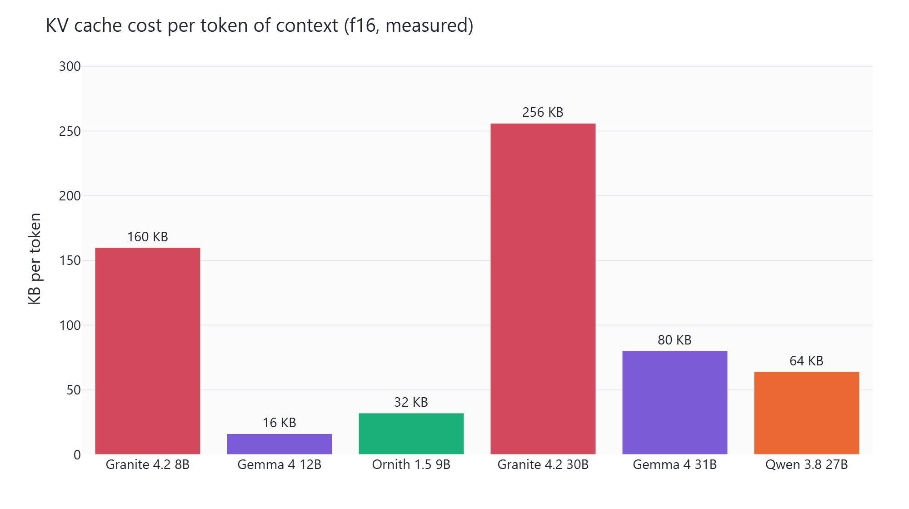
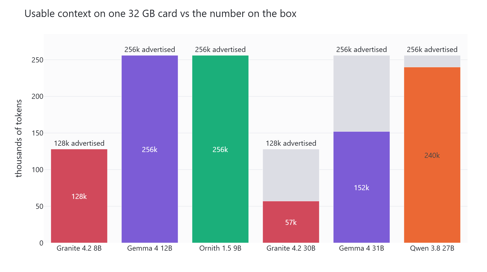
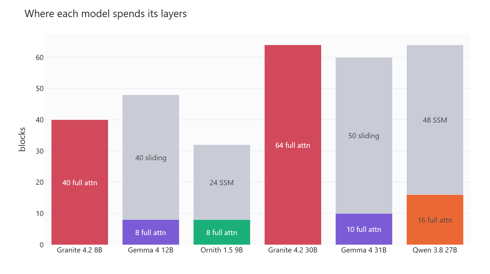
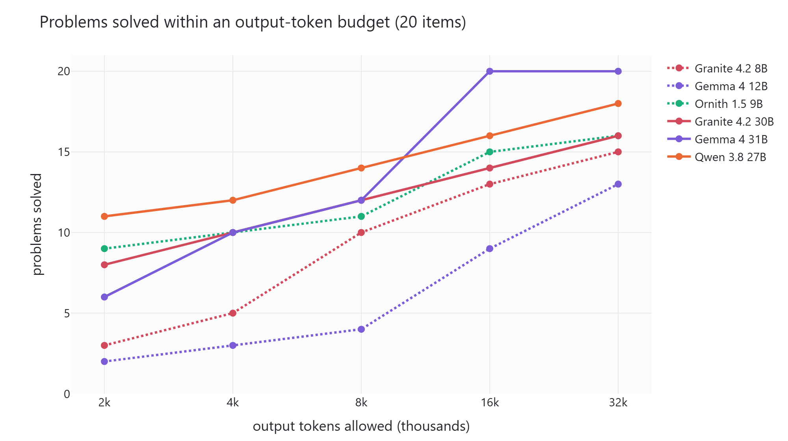

# Granite 4.2 benchmark

Two three-way brackets on one RTX 5090, all six models Q4_K_M on the same
`llama-server` build.

| Bracket | Models |
| --- | --- |
| A, about 8 GB of weights | Granite 4.2 8B, Gemma 4 12B, Ornith 1.5 9B |
| B, matched dense ~30B | Granite 4.2 30B, Gemma 4 31B, Qwen 3.8 27B |

See [PROTOCOL.md](PROTOCOL.md) for what is held constant and why, including
the two traps this rig has taught us the hard way: Windows CUDA silently
spilling past VRAM instead of failing, and a power-capped card that makes any
cross-session speed comparison meaningless.



## Layout

```
research/     harness and eval definitions
results/      one jsonl per stage
logs/         server logs and stage logs
models/       GGUFs downloaded for this project
```

## Reproducing

```bash
python research/problems_hard.py     # re-derive every math answer key
python research/problems_code.py     # reference code passes all 99 asserts
python research/models.py            # check every GGUF resolves
python research/run_all.py --stage all
python research/analyze.py           # markdown tables for the write-up
```

## Eval design

The previous round on this rig saturated: five models scored 39/40 on graded
reasoning and 18/18 on agentic tool use, so the only thing it could measure was
cost. This set is built to break at least one model:

- **math** - 12 items, answers produced by brute-force solvers in the repo
- **trap** - 8 items with no valid answer, scored alongside the solvable ones
- **format** - 8 items graded by a predicate over the reply
- **code** - 9 precise specifications, 99 hidden asserts, actually executed
- **agentic** - pagination, forced error recovery, and two unanswerable tasks
- **multihop** - three chained hops at 8k / 32k / 96k of distractor fill

No LLM judge is used anywhere. Truncation is recorded and re-tested at a larger
budget rather than being scored as a wrong answer.

## Charts

Redrawn from `results/` by `figures/make_figures.py`.





*Advertised context and usable context are different numbers. What fits on one
32 GB card is the one that decides anything.*





*A model that answers correctly but spends several times the tokens getting
there is a different proposition in production, which is why the budget is
charted next to the accuracy rather than inside it.*
