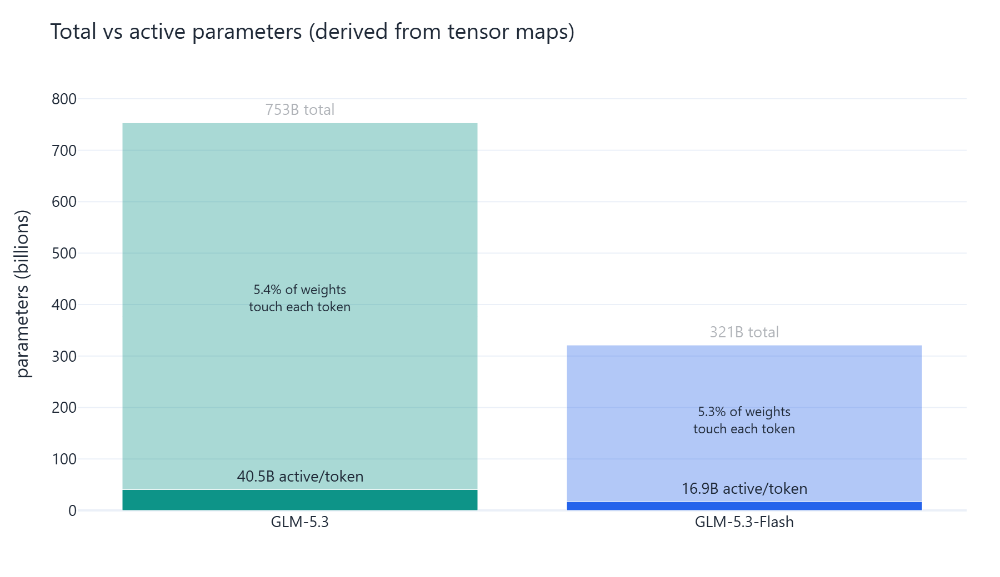
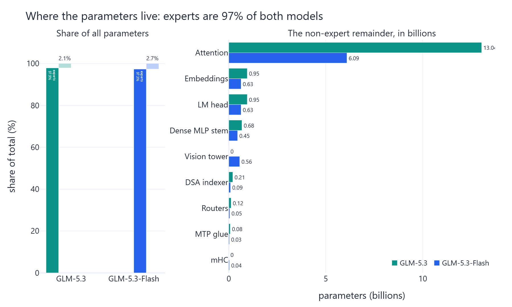
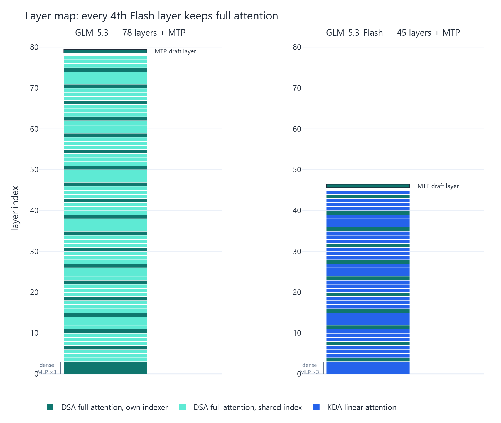
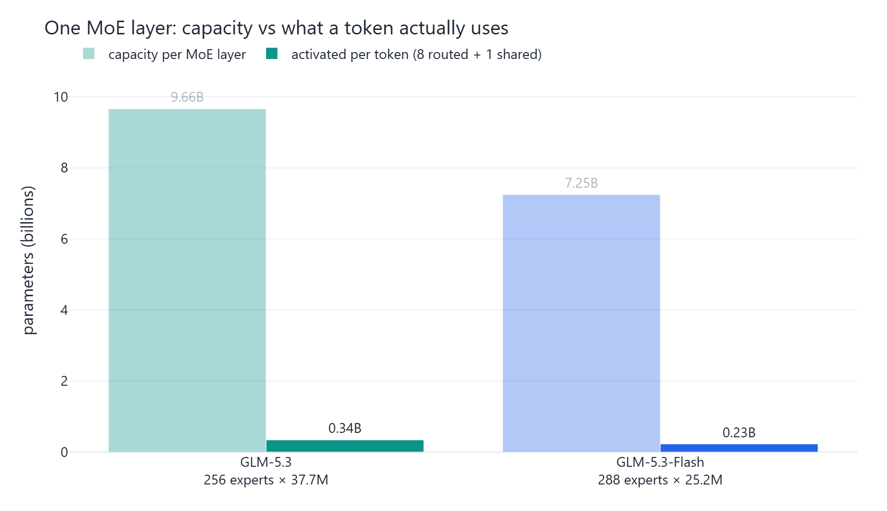
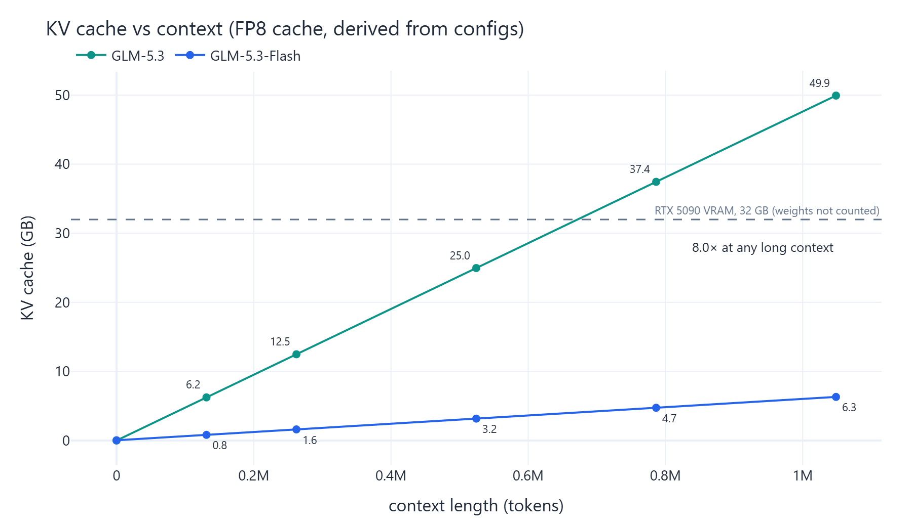
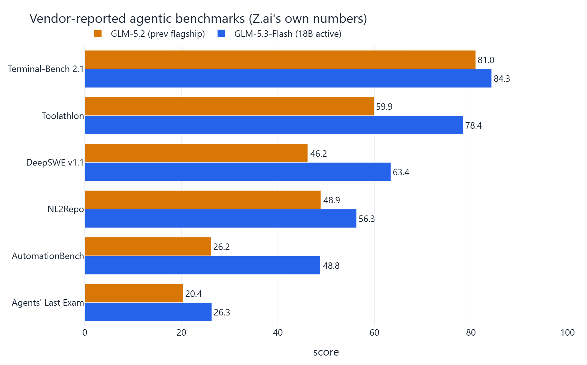

# Lecture 197: GLM 5.3 and GLM 5.3 Flash architecture teardown

Architecture teardown of **zai-org/GLM-5.3** (744B-A40B text model, DSA
attention) vs **zai-org/GLM-5.3-Flash** (320B-A18B natively multimodal
hybrid KDA + DSA model). No weights were downloaded and nothing was run
on the rig; this is a pure config + weight-map teardown.

*Counted from the weight maps: 753.3B parameters across 118,629 tensors for
GLM-5.3, of which 40.5B are active per token, against 321.3B across 76,108
tensors for Flash, of which 16.9B are active.*

---

## What the two models are made of

*Routed experts are 97% of GLM-5.3 and 97% of Flash. Everything that makes the
two models architecturally different lives in the remaining 3%.*

Two components appear in Flash and have no counterpart in GLM-5.3: a 563.6M
parameter vision tower, and 35.4M parameters of hyper-connections spread over
270 tensors. Both models carry a DSA indexer, 206.2M parameters in GLM-5.3 and
89.7M in Flash.

---

## The cache gap

*Derived from the configs, not measured: GLM-5.3 caches 78 DSA layers at
92.5 KB per token, Flash caches 11 at 11.6 KB per token, an 8.0x difference.
Flash pays for it with a 71.3 MB KDA state per sequence, which is a fixed cost
rather than one that grows with context.*

Dropping key pooling in Flash would raise the indexer side from 352 to 1,408
elements per token, taking the total from 11.6 to 12.7 KB per token.

---

## Vendor benchmarks

These are the vendor's self-reported numbers, carried over as published and
marked as such. Nothing in this project measures model quality.

---

## Raw sources of truth

- `models/glm53_config.json`: fetched 2026-08-30 from
  `zai-org/GLM-5.3` main branch.
- `models/glm53_flash_config.json`: fetched 2026-08-30 from
  `zai-org/GLM-5.3-Flash` main branch.
- `models/glm5_config.json`: `zai-org/GLM-5`, for lineage comparison.
- `results/architecture_analysis.json`: every parameter count, active
  parameter count and cache figure quoted above.
- `results/vendor_benchmarks.json`: the vendor scores, with provenance.
- `logs/`: the fetch and analysis runs that produced all of it.

The `model.safetensors.index.json` weight maps and the complete
`{tensor: {dtype, shape}}` dumps are not committed, because they run to tens of
megabytes. `research/fetch_headers.py` regenerates them: it reads the JSON
header of every safetensors shard over HTTP range requests (141 shards for
GLM-5.3, each header a few tens of KB), so the weights themselves stay on the
Hub.

## Analysis

- `research/fetch_headers.py`: builds the tensor maps from shard headers.
- `research/analyze.py`: groups all tensors into components, computes
  parameter counts per component, derives KV-cache-per-token math, and
  writes `results/architecture_analysis.json`.
- `figures/make_figures.py`: renders the charts above from that file.

All parameter counts and cache sizes here are **derived from the raw
files**, not measured on hardware. Benchmark scores are the vendor's
self-reported numbers, marked as such.
